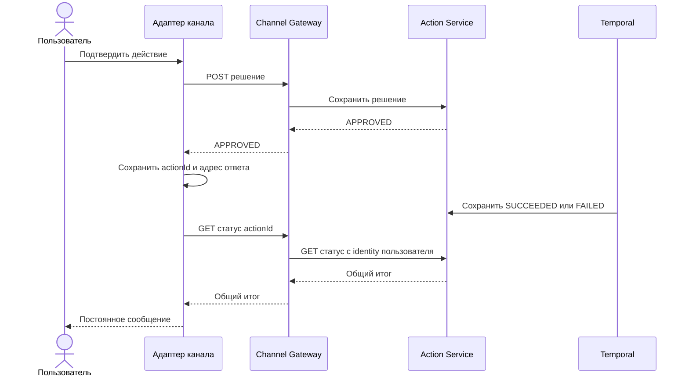

# ADR-0017: результат действия доступен каждому каналу

- Статус: принято для MVP
- Дата: 2026-10-26

## Контекст

`Action Service` сохраняет итог после выполнения в Temporal. Ответ на кнопку подтверждения приходит
раньше этого итога. Telegram сейчас показывает только короткое `Решение принято.` во всплывающем
уведомлении. Web и будущие каналы тоже должны получать один и тот же статус действия.

## Решение

1. `Action Service` остаётся источником статуса и результата. Чтение действия проверяет и `tenantId`,
   и пользователя, который его создал.
2. `Channel Gateway` даёт защищённый `GET /api/v1/actions/{actionId}/status`. Ответ содержит только
   `actionId`, `status`, `kind` и безопасный итог. Gateway не хранит подписки и не знает Telegram chat id.
3. Канал сам хранит адрес ответа. Telegram Adapter сохраняет ожидающий `actionId` вместе с chat id после
   подтверждения, проверяет общий статус в фоне и отправляет постоянное сообщение при `SUCCEEDED`,
   `FAILED` или `CANCELLED`. После перезапуска незавершённые проверки остаются в PostgreSQL.
4. Текст сообщения строится из общего результата действия. Адаптер переводит его в формат Telegram;
   правила выполнения календаря в нём не появляются. Web-клиент может читать тот же статус без Telegram.
5. Повтор проверки не создаёт повторное действие. Отправка сообщения в Telegram и отметка в нашей БД
   не образуют одну транзакцию, поэтому после сбоя возможна повторная доставка. Этот предел виден в
   документации и тестах.

## Почему так

Этот срез использует уже имеющиеся HTTP, PostgreSQL и проверку identity. Новый брокер и отдельный
сервис доставки пока не нужны. Когда частые проверки статуса станут измеримой нагрузкой, можно
заменить их событием из Action Service. Контракт результата и место хранения адреса канала при этом
остаются прежними.
